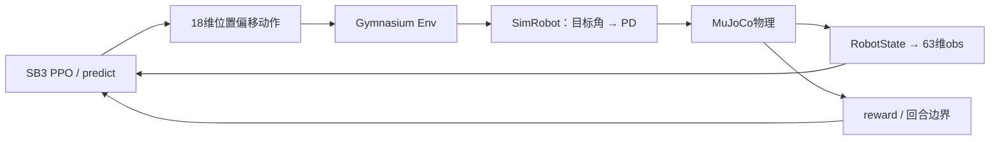

# 六足机器人运动控制研究与实验平台

基于 **MuJoCo + Gymnasium + Stable-Baselines3 PPO**，研究六足机器人强化学习运动控制。

- **长期目标**：面向真实工程场景，逐步实现稳定控制、复杂地形泛化、环境自适应和Sim-to-Real部署。
- **当前阶段**：PPO基础训练系统及相关研究；模型检查、环境交互、训练保存/恢复和推理已跑通。
- **当前成绩边界**：历史短训确定性策略前进速度接近零，尚无有效行走、未知地形泛化或实机部署成果。所有现有入口仅运行仿真。

先读 [学习手册导航](guide/README.md)，直接操作查 [训练与实验手册](guide/09_experiments.md)，未来路线查 [工程化路线](guide/10_engineering_roadmap.md)。

## 工程基础与目录

本项目在six_leg-1.1-RL.zip的既有工程上整理，复用两份MJCF、19个STL、质量惯量、18关节及方向映射、stand姿态、位置偏移PD语义与SB3 PPO。没有重新构造六足模型或另写PPO。来源和历史改动见 [原包分析](docs/archive_analysis.md)、[文件清单](docs/archive_manifest.json)。

```text
six_leg_lzx-1.1-RL/
├── configs/                 robot.yaml、train.yaml
├── mujoco/
│   ├── hexapod_rl.xml       默认训练模型
│   ├── hexapod_dynamic.xml  原比较模型
│   ├── robot_interface.py  数据/关节/观测约定
│   ├── sim_robot.py        模型、状态、位置PD与物理推进
│   ├── hexapod_rl_env.py   Gymnasium reset/step与回合管理
│   ├── rewards.py          六项评分
│   ├── train_ppo.py        训练调度、回调、保存与恢复
│   ├── validation.py       模型/配置/接口契约
│   └── ...                 原兼容驱动、生成器、Linux参考文件
├── meshes/                 19个STL，勿改变模型相对目录
├── scripts/                inspect_robot、random_test、train、play
├── tests/test_env.py        环境边界回归
├── guide/                  架构、机制、实验、排查与工程路线
├── docs/                   资产审计、历史证据、实验模板、整理报告
├── requirements*.txt       直接依赖与环境快照
├── LICENSE                 MIT软件许可证
├── LICENSES/               CC BY 4.0完整文本
├── LICENSING.md            许可证范围与署名示例
├── THIRD_PARTY_NOTICES.md   项目来源、特别鸣谢与依赖许可
├── logs/                   本地产物，Git忽略
└── checkpoints/            本地产物，Git忽略
```



## 安装与第一次运行

当前已在Windows、Python 3.11.9、CPU验证：MuJoCo3.14.0、Gymnasium1.3.0、SB3 2.9.0、PyTorch2.14.1+cpu。未验证CUDA训练或Linux完整流程。环境旧记录见docs/environment.json，本次检查见 [整理报告](docs/documentation_review_20261105.md)。

新机器独立安装；已有可用.venv可跳过创建/安装：
```powershell
py -3.11 -m venv .venv
.\.venv\Scripts\python.exe -m pip install -r requirements.txt
.\.venv\Scripts\python.exe -m pip check
```

全部命令从本工程根目录执行，不需激活环境。requirements-lock.txt是完整版本快照，可代替requirements.txt安装；不保证跨平台wheel可用，不需要升级全局Python/CUDA。设备类型以实际安装结果为准。

第一条仿真检查命令：
```powershell
.\.venv\Scripts\python.exe scripts\inspect_robot.py
```

随后验证、短训练和推理：
```powershell
.\.venv\Scripts\python.exe scripts\random_test.py --episodes 10
.\.venv\Scripts\python.exe -m unittest discover -s tests -v
.\.venv\Scripts\python.exe scripts\train.py --steps 4096 --run-name first_run_01
.\.venv\Scripts\python.exe scripts\play.py --checkpoint checkpoints\first_run_01\final.zip --headless --episodes 5 --seed 100 --output logs\first_run_01\play.json
```

去掉--headless显示画面。训练前要求两个默认检查报告匹配当前契约；新克隆不含logs/checkpoints，先生成报告和自己的模型。run-name必须新建，避免覆盖旧训练；play的同名输出会覆盖。Gymnasium对无限观测Box的提示不等于数据已出现Inf，覆盖范围见 [验证说明](guide/08_random_validation.md)。

继续训练与日志：
```powershell
.\.venv\Scripts\python.exe scripts\train.py --resume checkpoints\first_run_01\final.zip --steps 4096 --run-name resume_run_01
.\.venv\Scripts\tensorboard.exe --logdir logs
```

恢复使用保存模型的PPO参数与计数，开始新的仿真回合；修改YAML学习率不会自动覆盖checkpoint。实际采样步数按完整rollout取整。正式实验准备、有效参数记录和固定种子评估见 [09](guide/09_experiments.md)。

## 接口摘要与能力限制

Observation=(63,) float32：机身线速度3、角速度3、单位重力投影3、相对站姿关节角18、关节速度18、上一采用动作18。没有VecNormalize或速度命令，详细单位和坐标见 [03](guide/03_observation_action.md)。

Action=(18,)，表示stand周围0.35 rad尺度的位置目标偏移；经过符号、关节限位，再由500Hz PD生成±7 N·m内的仿真力矩。策略50Hz决策，不能将仿真限值直接当作实机能力。

Reward仅六项：世界X前进、倾斜、角速度、动作差分、机械功代理和失败事件。前进cap=0.25 m/s是计分饱和点，尚无准确速度跟踪。Reset恢复stand并加小初态扰动；高度/姿态/关节异常终止，12秒正常截断，见 [02](guide/02_environment.md)、[04](guide/04_reward.md)。

当前缺少自动零动作对照/独立测试调度、地形生成、物理域随机化、课程学习和实机后端。碰撞/惯量/摩擦/执行器未标定，未启用腿间自碰撞，lm_coxa碰撞及模型生成器仍需核验。当前多环境为DummyVecEnv顺序推进。训练reward和有限loss不能代替行为、泛化或部署评估。

## 发布与复现状态

项目已建立独立Git仓库并发布至 [GitHub](https://github.com/qleoqq-lang/hexapod-rl)。环境、日志、模型权重和构建产物由.gitignore排除；保留少量可读证据在docs，不上传.venv或完整训练日志。

工程代码、机器人模型与配套资料均基于团队自有成果。**特别鸣谢张书铭学长设计本项目使用的六足机器人，为仿真、控制与强化学习研究提供基础。**

## 许可证

- **软件代码、脚本及配置：** [MIT](LICENSE)。
- **两份MJCF、全部STL模型及文档：** [CC BY 4.0](LICENSES/CC-BY-4.0.txt)。

各自覆盖的文件、文档代码片段的授权及署名示例见[许可证适用范围](LICENSING.md)。第三方运行依赖保留各自许可证，见[来源、鸣谢与依赖说明](THIRD_PARTY_NOTICES.md)。

本次整理的合并记录、真实验证结果、未实施建议和下一步清单见 [审查交付报告](docs/documentation_review_20261105.md)。
