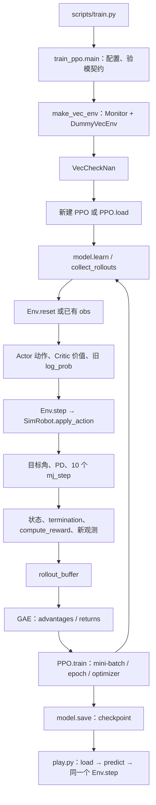

# 00 项目架构与训练链路

本项目定位为基于强化学习的六足机器人运动控制研究与实验平台。当前阶段是 MuJoCo 平地上的 PPO 基础训练系统；长期目标是可评估、可迁移、可部署的复杂地形与自适应运动控制。后续方向见 [工程化路线](10_engineering_roadmap.md)，操作入口见 [实验手册](09_experiments.md)。

## 当前能力与边界

已实现模型检查、随机动作、Gymnasium 环境、SB3 PPO 训练/保存/恢复和单环境推理。历史短训模型在 2026-11-02 的两个 12 秒回合中平均前进速度接近零：闭环已通，尚无有效行走证据。

尚未实现速度/转向命令、复杂地形生成、物理域随机化、课程学习、历史状态堆叠、循环策略、RMA、CPG、实机通信和状态估计。reset 的小扰动不是完整域随机化。不存在自动“最佳策略”选择、训练中独立评估或现成零动作对照入口。

## 目录与核心文件

```text
six_leg_lzx-1.1-RL/
├── configs/       robot.yaml（任务/控制）与 train.yaml（训练运行）
├── mujoco/        自有 Python 模块及两份 MJCF
├── meshes/        19 个 STL，模型相对引用
├── scripts/       验模、随机测试、训练、推理四种启动入口
├── tests/         8 项环境边界回归
├── guide/         按主题组织的学习与实验手册
├── docs/          原包清单、资源审计、历史证据、实验模板及本次审查
├── logs/          本地产物，Git 忽略；新克隆需自行生成
├── checkpoints/   本地产物，Git 忽略；不随源码保证提供
└── .venv/         独立运行环境，Git 忽略
```

| 文件/对象 | 职责 | 主要调用者 |
|---|---|---|
| scripts/train.py | 引导模块路径，调用 main | 命令行 |
| mujoco/train_ppo.py: main、FiniteTraining | 配置、验模门、训练调度、日志、保存 | train.py |
| mujoco/hexapod_rl_env.py: HexapodMuJoCoEnv | reset/step、空间声明、评分与回合边界 | SB3、play、random_test |
| mujoco/sim_robot.py: SimRobot | 加载模型、状态读取、PD 控制和物理推进 | Env、inspect_robot |
| mujoco/robot_interface.py | 关节顺序、RobotState、make_observation、Protocol | SimRobot、Env、validation |
| mujoco/rewards.py: compute_reward | 六项评分 | Env.step |
| mujoco/validation.py | 生成契约、检查历史报告 | train、play、检查脚本 |
| scripts/play.py | 加载策略、手动回合循环、运动结果 JSON | 命令行 |

核心首次阅读 TOP 5：train_ppo.py → hexapod_rl_env.py → sim_robot.py → robot_interface.py → rewards.py。五行 scripts/train.py 作为入口先扫一眼即可。

configs 是数据，不拥有循环；logs/checkpoints 是证据与产物；原兼容驱动、模型生成器、Linux 参考脚本和第二份 MJCF 按需查，不参与默认训练主线。项目目录 mujoco/ 存自有模块，import mujoco 则导入第三方物理库；_bootstrap 将该目录加到模块搜索路径。

## 谁实现了什么

| 层 | 自有代码 | 第三方职责 |
|---|---|---|
| 任务 | 空间、观测、评分、结束规则 | Gymnasium 给出接口和随机数基类 |
| 控制与物理 | 目标角/符号/PD、诊断 | MuJoCo 编译 XML、积分、接触求解 |
| 学习 | 创建 PPO、传参数、回调和契约 | SB3 的 rollout、GAE、PPO 更新、保存加载 |
| 网络 | 选择 MlpPolicy | PyTorch 张量、自动微分、Adam；SB3 构建 Actor/Critic |
| 评估 | play 的回合循环和有限运动指标 | SB3 predict 内部的前向计算 |

## 完整训练流程



learn 内部反复调用环境，不是这些文件各执行一遍。采样阶段推进物理；网络更新阶段使用已有数据，不额外执行机器人动作。训练中的回合结束由 VecEnv 自动 reset；play/random_test 由各自外层循环手动 reset。

## 数据形状总览

N 是环境数，T=n_steps，B 是训练 mini-batch 样本数。

| 位置 | 输入/输出 |
|---|---|
| make_observation、原始 Env | obs (63,)、action (18,)、reward 标量 |
| VecEnv / policy | obs (N,63)、action (N,18)、reward/done (N,) |
| rollout_buffer | obs (T,N,63)、action (T,N,18)；标量字段 (T,N) |
| 更新的一个 batch | obs (B,63)、action (B,18)、advantage/return (B,) |
| play 的 predict | 外部 (63,) → (18,)；网络内部临时用 (1,63) |

shape 相同不代表含义相同；关节顺序、坐标、单位、动作尺度都是策略接口的一部分。详细来源见 [03](03_observation_action.md)。
