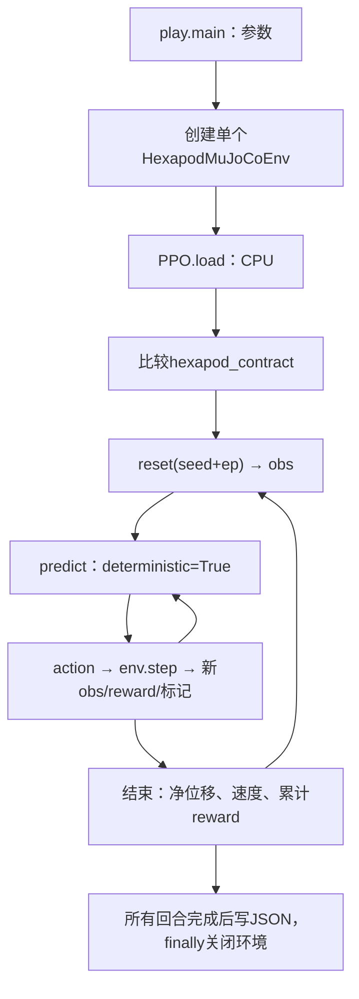

# 07 推理与行走效果评估

源码：[scripts/play.py](../scripts/play.py)。训练好的策略仍需每步反馈决策；checkpoint不是录好的动作序列。命令集中在 [09](09_experiments.md)。

## 完整推理调用链

直接创建单环境，没有VecEnv。默认2回合、seed=100，下一回合seed=101。reset仍有初态扰动。结束时break退出内循环，下一回合显式reset，最后一回合结束后直接关闭。

## predict的输入输出

单环境obs (63,) → 内部tensor (1,63) → Actor动作 (1,18) → NumPy裁剪并移除样本维 → action (18,)。手动加batch维会让输出保留(1,18)，当前控制层会拒绝。

deterministic=True对当前高斯策略取均值，再按[-1,1]裁剪；不是所有时刻动作相同。换成False只改变采样方式，不执行学习或关闭reset扰动。predict内部使用eval模式和no_grad，当前MLP走Actor分布路径，Critic不参与选动作。

返回的第二项是循环网络状态接口，普通MlpPolicy为None；reset返回值中的第二项则是info，两处下划线忽略的对象不同。

PPO.load没有传env，脚本自行把obs送模型、action送环境；契约核对进一步约束语义。play不调用require_validation重读两个检查报告。加载不会恢复物理现场，也不增加训练计数。

## 画面与时间

human模式下reset/step内调用render；脚本用perf_counter估计计算耗时，再sleep到接近0.02秒/控制步。计算慢时不补等，不能保证硬实时。headless关闭画面和主动等待，仿真dt保持不变。关闭viewer不会自动中止回合循环。

## JSON每个字段的准确含义

| 字段 | 当前含义 |
|---|---|
| trained_timesteps | checkpoint保存的训练计数，推理不增加 |
| episodes[i].steps | 本次回合控制步数 |
| reward | 原始环境reward逐步累加，没有乘gamma或超时价值补偿 |
| displacement_x_m | base_link原点的世界X净位移，不是行走路径总长 |
| mean_forward_m_s | 净位移/(steps×控制dt)，分母是仿真时间 |
| terminated/truncated | 任务失败/时限标记，可同时为True |
| termination_reasons | 失败原因列表；普通超时一般为空 |
| inference_passed | 指定回合流程正常完成，不设运动成绩阈值 |

一个每回合都摔倒的策略也可能inference_passed=True。当前输出不包含逐步姿态、动作、分项reward、独立多种子统计或零动作对照。不能从这个文件直接得出全部工程指标。

JSON在所有回合完成后统一写出，write_text会覆盖同名文件。异常中断时finally释放环境，但不会写一份完整新结果；已有旧文件不应误认作本次输出。保存命令、seed和依赖版本，不能只留JSON。

## 怎样判断真的会走

先定义测试要求和种子，再看前进净位移/速度、时长、任务失败原因、姿态及负载。terminated还含关节越界、高度异常，不可不加定义就叫跌倒率。

同种子零动作对照很有价值：零动作让PD追踪stand，它可能已能站住。策略至少应显示可重复的额外前进，同时保持预先定义的稳定性。当前没有这个成套比较入口，见 [实验设计](09_experiments.md)。

历史事实：2026-11-02加载5120步checkpoint，两回合各600步，位移约-0.00014547、+0.00010473 m，速度约-1.21e-5、+8.73e-6 m/s，均普通超时。支持推理闭环正常，不支持学会行走。原日志不随Git上传，数字摘录留在 [审查记录](../docs/documentation_review_20261105.md)。

自查：执行两个600步推理回合后，trained_timesteps仍是5120；新增1200步属于推理交互。
